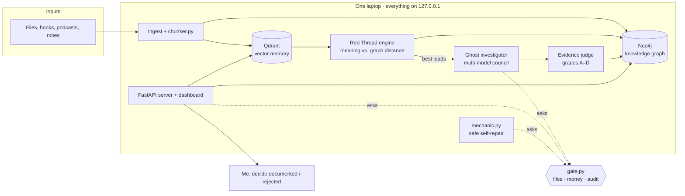

# CHANCO OS — a local-first AI operating system, built so the AI can't hurt its owner


CHANCO is my personal AI operating system. It runs entirely on one laptop (i7, 30 GB RAM, Linux) and works through the night: it reads what I feed it, builds a knowledge graph, looks for **hidden connections between distant ideas**, sends an AI investigator to research the most promising ones, grades the evidence, and gives me a one-page report at 7:30 every morning.

This repository is a **case study plus the safety core**: the design, the trade-offs, and three production modules with their tests. The full system stays private because it holds my data, so what's published here is the engineering.

> **Core rule: the AI proposes, plain code decides.**
> A rule written in a prompt is a wish. A rule written in code is a wall.

---

## Architecture



| Layer | Choice | Why |
|---|---|---|
| Server | FastAPI, split into small route modules | Each part can be tested and repaired on its own |
| Memory | Qdrant (768-dim embeddings, local) | Fast semantic search, no data leaves the machine |
| Graph | Neo4j | Connections are the product: paths, distances, clusters |
| Models | Local LLM + Groq / Gemini / Claude | Cheap or free by default; strong models only when worth it |
| Scheduling | systemd user timers (`Persistent=true`) | Survives sleep and reboots; jobs catch up when the laptop wakes |
| Backups | Nightly DB snapshots + encrypted Duplicati copy | Proper exports, not copies of live files; restore tested |

---

## The safety design (the part I'm proudest of)

An agent that reads the web at night and can edit code is only useful if a poisoned web page can't take it over. Every protection below is **code, with a test that attacks it**.

| Threat | Protection | Proof |
|---|---|---|
| Another device or website calls the API | Server bound to `127.0.0.1`; Host and Origin checked (blocks DNS rebinding); CORS locked | Lab: evil origin and rebinding host get **403** |
| AI reads private files or keys | Read **allowlist** plus secret-name filter, in `gate.py` | Lab: SSH key and API key reads refused; normal notes still readable |
| Path traversal (`../../.bashrc`) | Filenames cleaned, real paths checked against allowed folders | Lab: upload cannot overwrite the shell profile |
| Prompt injection from web pages | **Taint lock**: once untrusted web text enters a conversation, code-changing tools are locked for that turn | Test: fake page says "patch tool.py"; the patch is refused |
| Runaway costs | Per-model pricing, **daily cap in code**; unknown models priced as expensive | `test_gate.py` |
| Self-repair breaks the system | `mechanic.py`: exactly-once match → compile → full test suite → keep and git commit, or roll back | `test_mechanic.py` |
| Agent loosens its own rules | `gate.py` and `config.py` can never be patched; the live server and `mechanic.py` itself only accept **human-approved proposals** | `test_gate.py`, `test_mechanic.py` |
| Overconfident AI evidence | Evidence grades capped in code (one source ≤ B; anonymous or social-only ≤ C; no source = D) | Private test suite |

The private system runs **more than 140 automatic tests** (including a 10-attack security lab in a throwaway home folder) before every commit, through a git pre-commit hook.

---

## Reliability: the night shift must never lie or lose work

A code review of the overnight jobs (November 2026) found that some of them could fail quietly. Each fix below is plain code with tests; the new tests were also run against the **old** code to prove they catch the problem.

| Problem found | Fix | Proof |
|---|---|---|
| After a reboot, the server started before the OS keyring unlocked, retried an old database password every 30 s and locked the database account | A readiness check logs in for real and **never retries a refused password**; the server now waits for the unlocked keyring before starting | Lab: a refused login is tried exactly once; zero failed logins in 70 s after the fix |
| Night steps ran even when a database was down, and each one crashed on its own | Every step declares what it needs; when that is down it is **skipped and reported**, and one failed step no longer blocks the others | The real pipeline script run in a throwaway home folder with fake steps |
| The web hunter reported success even when nothing was saved | Honest counts (new / already known / skipped / errors), a real exit code, and one summary line per step in the night log | Tests with the embedding service switched off |
| The investigation queue was rewritten from a stale copy, silently erasing leads added in the meantime; dossiers rejected by the safety check still counted as done | A small database queue: retries with growing waits, then the lead is **kept on record as failed, never deleted**; jobs cut off by a crash go back in the queue | 29 new tests; 17 of them fail on the old code |

The changes went in through an installer that refuses files changed since testing, backs everything up, runs the whole suite, and **rolls itself back** if a single test fails.

---

## What's in this repository

| File | What it does |
|---|---|
| [`gate.py`](gate.py) | One place that decides what agents may **read**, **patch** and **spend**, and writes every decision to an audit log. Stdlib only. |
| [`mechanic.py`](mechanic.py) | Safe self-repair: an agent's code fix is kept **only if the whole test suite still passes**, committed alone in git (undo = `git revert`), otherwise rolled back. Files of the running server become **proposals** a human approves (`--list / --apply / --reject`). |
| [`chunker.py`](chunker.py) | Cuts text for embeddings: pieces ≤ 1500 characters, ending at sentences, with overlap that starts at a sentence. Replaced blind 2000-character slices that cut ideas in half and went past the embedding model's ~512-token limit. |
| [`tests/`](tests) | 18 tests. Run them: `python3 -m unittest discover -s tests -v` (Python 3.10+, no dependencies; git needed for the Mechanic tests). |

```python
import gate, mechanic

ok, real = gate.can_read("notes/today.md")       # allowlist + secret filter
ok, why  = gate.budget_ok(0.01)                  # would this call stay under today's cap?
gate.spend("groq", "openai/gpt-oss-120b", api_response["usage"], actor="investigator")

result = mechanic.apply("worker.py", old_text, new_text, actor="agent")
# {"status": "done" | "proposed" | "failed", "message": "Repaired worker.py: tests pass, saved in git. Undo: git revert HEAD"}
```

---

## Lessons that shaped it

1. **Fix in order of damage, not in order of discovery.** The first review ranked findings by "what does the most harm, most easily". An open network port came before any feature.
2. **Foundations before intelligence.** One config file, secrets in the OS keyring, and git came first. The clever parts depend on them.
3. **Clean data before discovery.** Duplicate graph nodes ("Dark_Energy" vs "dark energy") create fake "distant" ideas, so canonical names came before the connection engine.
4. **Link, don't merge.** Related ideas get linked rather than merged, so no path is ever erased.
5. **Suggest, never conclude.** Every discovered connection starts as *unverified*; only a human marks it documented or rejected, and rejected ones stay on record.
6. **Check, don't assume.** A database password change failed once because the real password wasn't the default. Since then, every step reads the real state before changing it.
7. **Proof over promises.** Every change was tested in a lab first, and the security lab was run against the old code too, to prove it catches the problem.
8. **Test the backup.** The first restore test failed on an exFAT drive (no symlinks, case-insensitive names). The second restored a file byte for byte. A backup you never restored is a hope.
9. **A green light must mean something.** A step that says OK while saving nothing is worse than a step that fails loudly.
10. **Never retry a refused password.** Retrying is what turns one wrong password into a locked account.

---

## About

Built by **Olivier Boukli** ([U-Ack-It](https://github.com/U-Ack-It)): background in network administration, construction site coordination and luxury client service, now building AI agent systems with safety in the code.

The same pattern (the AI proposes, plain code decides, everything on the record) now runs **[Obrava](https://github.com/U-Ack-It/obrava)**, a bilingual assistant for small construction companies that I'm building.

MIT license.
